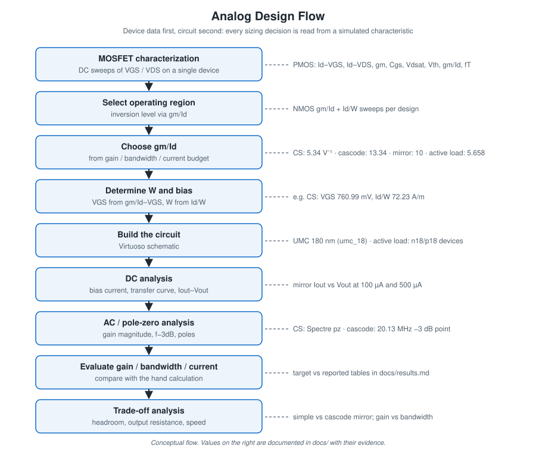

# Analog CMOS IC Design

**MOSFET characterization, gm/Id-based sizing, current mirrors, and transistor-level amplifier analysis in Cadence Virtuoso**

`Cadence Virtuoso` · `Spectre` · `ADE L` · `UMC 180 nm` · `gm/Id methodology` · `current mirrors` · `common-source` · `cascode` · `active load`

This repository is a set of analog CMOS design studies. Each study starts from simulated device data, turns it into transistor sizes and bias points with the gm/Id method, then checks the resulting circuit in DC and AC simulation. The work covers one PMOS characterization, two current-mirror topologies at two currents, and three single-stage amplifier topologies.

Every number in this README comes from a Cadence screenshot, a Spectre log, a schematic label or a hand calculation in the source reports, or is calculated here from those values. The tag on each number says which. Gaps and inconsistencies in the source material are listed openly in [docs/evidence-audit.md](docs/evidence-audit.md).

---

## Key Results

| Design | Metric | Value | Type | Evidence |
|---|---|---:|---|---|
| PMOS (UMC 180 nm, W/L = 1 µm/180 nm) | Channel-length modulation λ | −0.01219 /V | Reported (hand calc). The stated formula and inputs give ≈ −0.206 /V; see [recheck](docs/mos-characterization.md#lambda-recheck) | [PMOS docs](docs/mos-characterization.md) |
| PMOS | Body-effect coefficient γ | −0.418 | Reported (hand calc, re-verified: −0.4187) | [PMOS docs](docs/mos-characterization.md) |
| PMOS | Vth at VSB = 0 | −266.446 mV | Simulated (marker) | [07-vth-vs-vgs.png](device-characterization/pmos/07-vth-vs-vgs.png) |
| Common-source, resistive load | DC (midband) gain | 3.886 V/V (11.79 dB) | Simulated (Spectre pz). Report text says "≈ 3.8 V/V" | [Spectre log](amplifiers/common-source/cs-spectre-pz-log.png) |
| Common-source | Dominant pole | 25.97 MHz | Simulated (Spectre pz) | [Spectre log](amplifiers/common-source/cs-spectre-pz-log.png) |
| Common-source | Gain × pole frequency | ≈ 100.9 MHz (target GBW 100 MHz) | Calculated from the two values above | [docs](docs/common-source.md) |
| Simple / cascode mirror | Reference currents | 100 µA and 500 µA | Schematic source values | [mirror docs](docs/current-mirrors.md) |
| Cascode mirror | Iout at VOUT = 1.8 V | ≈ 100 µA / ≈ 505 µA | Read from plot gridlines (approximate) | [plot](current-mirrors/cascode/cascode-mirror-iout-vs-vout.png) |
| Simple mirror | Iout at VOUT = 1.8 V | ≈ 205 µA / ≈ 740 µA | Read from plot gridlines (approximate) | [plot](current-mirrors/simple/simple-mirror-iout-vs-vout.png) |
| Cascode amplifier | Max gain (as reported) | 17.7657 dB vs 20 dB target | Reported. The plot suggests this value is the −3 dB marker level; see [note](docs/cascode-amplifier.md#reading-the-ac-plot) | [AC plot](amplifiers/cascode/cascode-ac-response.png) |
| Cascode amplifier | f−3dB | 20.1298 MHz vs 20 MHz target | Simulated (marker) | [AC plot](amplifiers/cascode/cascode-ac-response.png) |
| CS with active load | Max gain / f−3dB / 0 dB frequency | 18.966 dB / 11.9539 MHz / ≈ 105.7 MHz | Reported, handwritten only (no AC screenshot) | [docs](docs/active-load.md) |

Full table with every intermediate value: [docs/results.md](docs/results.md).

---

## Analog Design Flow

Every design follows the same loop. A device testbench is swept in DC. gm/Id, I_D/W and V_GS are read from the plots with markers. W is computed from the target current, then the circuit is built and simulated. The simulated gain, bandwidth or current is compared with the hand calculation that produced the sizes.

---

## MOSFET Characterization

A hand-analysis model such as the square law is not accurate enough at L = 180 nm to set bias points. The studies therefore characterize the real model card first and size from that data.

**PMOS (UMC 180 nm, `umc_18` library, P_18_MM, W/L = 1 µm / 180 nm).** Source and bulk are at ground. V_GS and V_DS are swept from −1.8 V to 0 V, with parametric families for both. Nine characteristics were plotted: I_D–V_GS, I_D–V_DS, gm–V_GS, Cgs–V_GS, Vdsat–V_GS, I_D/W–gm/Id, Vth–V_GS, gm/Id–V_GS and fT–gm/Id. λ and γ were then extracted by hand.

**NMOS (UMC 180 nm, N_18_MM, L = 180 nm).** NMOS was not characterized as a standalone study. Every NMOS design instead begins with its own gm/Id–V_GS and I_D/W–gm/Id sweep, at the drain bias that circuit will see.

| gm/Id vs V_GS (PMOS) | I_D/W vs gm/Id (PMOS) | fT vs gm/Id (PMOS) |
|---|---|---|
|  |  |  |

Details: [docs/mos-characterization.md](docs/mos-characterization.md)

---

## gm/Id Design Methodology

gm/Id (in V⁻¹) measures how efficiently a device turns bias current into transconductance. It is high (≈ 25–32 V⁻¹ in these plots) in weak inversion and falls toward ≈ 1–5 V⁻¹ in strong inversion. It maps one-to-one onto V_GS and onto the current density I_D/W, which is roughly independent of W. A target gm and I_D therefore fix gm/Id, the plots give V_GS and I_D/W, and W = I_D / (I_D/W).

| Design | Target gm/Id (V⁻¹) | V_GS from sweep | I_D/W from sweep | W used |
|---|---:|---:|---:|---:|
| CS, resistive load | 5.34 | 760.986 mV | 72.229 A/m | 8.4 µm |
| Current mirrors | 10 | 589.028 mV | 27.040 A/m | 18.49 µm |
| Cascode amp, input M2 | 13.34 | 573.927 mV | 12.034 A/m | 46.5 µm |
| CS active load, NMOS | 5.658 | 783.739 mV | 56.871 A/m | 9.76 µm (hand calc) |

(A/m is numerically equal to µA/µm.)

Details: [docs/gm-id-methodology.md](docs/gm-id-methodology.md)

---

## Common-Source Amplifier

An NMOS common-source stage with a 1.5 kΩ resistive load, CL = 5 pF and VDD = 1.8 V, designed for |Av| = 4 V/V (4.8 V/V with 20 % margin) and 100 MHz GBW. The output is biased at 0.9 V for maximum swing. This sets I_D ≈ 0.592 mA, gm = 2π·CL·GBW = 3.14 mS and gm/Id = 5.34 V⁻¹.

The Spectre pole-zero analysis reports a **DC gain of 3.88553 V/V** and a **single real pole at −25.97 MHz**. It also reports a right-half-plane zero at +154.1 GHz, from feed-forward through Cgd. Gain × pole ≈ 100.9 MHz, consistent with the 100 MHz GBW target (calculated).

Details: [docs/common-source.md](docs/common-source.md)

---

## Current Mirrors

Both mirrors use N_18_MM devices with W/L = 18.49 µm / 180 nm and were simulated at I_REF = 100 µA and 500 µA, with VOUT swept from 0 to 1.8 V.

### Simple Current Mirror

### Cascode Current Mirror

| Simple mirror: Iout vs VOUT | Cascode mirror: Iout vs VOUT |
|---|---|
|  |  |

**Observation from the plots (approximate gridline readings):**

- **Simple mirror.** Iout keeps rising with VOUT, to ≈ 205 µA (100 µA case) and ≈ 740 µA (500 µA case) at 1.8 V. With L = 180 nm, ro is low and the copy is accurate only near VOUT ≈ V_GS.
- **Cascode mirror.** Iout flattens to ≈ 100 µA and ≈ 505 µA once VOUT exceeds roughly 0.6–0.8 V. Output resistance is much higher, at the cost of that extra headroom.

Details: [docs/current-mirrors.md](docs/current-mirrors.md)

---

## PMOS Characterization

| Quantity | Value | Basis |
|---|---:|---|
| Technology / device | UMC 180 nm (`umc_18`), P_18_MM, W/L = 1 µm / 180 nm | Schematic + report text |
| Vth0 (VSB = 0) | −266.446 mV | Simulated marker |
| Vth at \|VSB\| = 1.8 V | −520 mV | Handwritten value, no plot in report |
| λ (reported) | −0.01219 /V | Hand calc; see recheck below |
| λ (recheck of the same formula and inputs) | ≈ −0.206 /V | Calculated in this repo |
| γ | −0.418 (recomputed −0.4187) | Hand calc, φF = 0.7 V as used in the report |

The negative signs follow the report's PMOS sign convention, with V_DS, I_D and Vth all negative. They are kept as reported. The λ recheck shows the published −0.01219 /V comes from two sign slips in the arithmetic, so the magnitude should be treated as unverified. [Full derivation](docs/mos-characterization.md#lambda-recheck).

---

## Cascode Amplifier

An NMOS cascode (M2 input, M1 cascode) with a resistive load, designed for **20 dB gain, 1 mW, 20 MHz bandwidth, CL = 5 pF** at VDD = 1.8 V.

| Metric | Target | Reported result | Status |
|---|---:|---:|---|
| Gain | 20 dB | 17.7657 dB (as reported) | Not claimed as met; see [plot reading](docs/cascode-amplifier.md#reading-the-ac-plot) |
| f−3dB | 20 MHz | 20.1298 MHz | Met (simulated marker) |
| CL | 5 pF | 5 pF | Schematic value |
| Power | 1 mW | Not simulated | Hand-calc bias 0.566 mA × 1.8 V ≈ 1.02 mW is a design value only |

Details: [docs/cascode-amplifier.md](docs/cascode-amplifier.md)

---

## Active-Load Amplifier

A common-source NMOS with a PMOS current-mirror load, targeting **100 MHz unity-gain bandwidth, 1 mW, CL = 5 pF and 200 mV overdrive**. Sizing used fresh NMOS and PMOS gm/Id sweeps (n18/p18 devices, W = 1 µm, L = 0.18 µm).

The report gives handwritten AC results: max gain 18.966 dB, f−3dB 11.9539 MHz and a 0 dB crossing near 105.7 MHz. No amplifier schematic or AC plot screenshot is included, so these are listed as *reported, not independently verifiable*. They are internally consistent: 8.88 V/V × 11.95 MHz ≈ 106 MHz.

Details: [docs/active-load.md](docs/active-load.md)

---

## DC Analysis

DC sweeps carry most of the work in this repository:

- **Device sweeps.** I_D–V_GS and I_D–V_DS families and their derived quantities (gm, gm/Id, I_D/W, Vdsat, Vth, Cgs), all used to pick V_GS and W.
- **Transfer and bias checks.** The CS drain current vs V_IN sweep shows conduction starting around 0.4–0.5 V, with the 771 mV bias on the steep part of the curve.
- **Mirror compliance.** Iout–VOUT sweeps from 0 to 1.8 V show where each mirror leaves triode and how flat its output current is.

Operating-region evidence is limited. See [docs/analysis-methods.md](docs/analysis-methods.md#operating-region-verification).

## AC Analysis

- **CS amplifier.** Spectre pole-zero analysis (`pz`) gives DC gain, pole and zero directly. The ADE "AC response" plot in the report shows the M1 drain-current magnitude, not V_OUT.
- **Cascode amplifier.** The V_OUT AC magnitude in dB20, with a marker at the −3 dB crossing.
- **Active-load amplifier.** AC results are reported in handwriting only.

No transient results exist for these blocks. The CS hand notes list transient analysis as a planned step, but no waveform is included.

---

## Design Tradeoffs

| Trade-off | General principle | What these studies show |
|---|---|---|
| Gain vs bandwidth | Av ≈ gm·R_out, p ≈ 1/(2π·R_out·C_L), so GBW ≈ gm/(2π·C_L) is fixed by gm | CS: gain × pole ≈ 100.9 MHz against a 100 MHz GBW target |
| Output resistance vs headroom | Cascoding multiplies R_out by ≈ gm·ro but raises the minimum output voltage by at least one Vdsat (≈ one V_GS with the stacked-diode bias used here) | Cascode mirror is flat above ≈ 0.6–0.8 V; simple mirror is never flat |
| Current accuracy vs complexity | Two more devices and a stacked bias | Cascode mirror Iout ≈ I_REF; simple mirror reaches ≈ 2× I_REF at 1.8 V (100 µA case) |
| Width vs capacitance | Higher gm/Id needs a wider device at the same current, so Cgs rises | Cascode input at gm/Id 13.34 needed W ≈ 46.5 µm; CS at 5.34 needed 8.4 µm |
| Cascode gain vs swing | Two stacked devices share 1.8 V | Hand design allotted 0.45 V V_DS per device |
| Sizing vs speed | fT falls as gm/Id rises | PMOS fT–gm/Id plot shows the monotonic trend |

---

## Results

All values, each with its type (target / simulated / calculated / reported) and evidence link: **[docs/results.md](docs/results.md)**.

## Simulation Evidence

All images are crops of the original Cadence screenshots. UI chrome, file paths, server names and user IDs have been removed; the curves, axes and marker values are unchanged. Index: [docs/repository-guide.md](docs/repository-guide.md).

| Block | Evidence folder |
|---|---|
| PMOS characterization (11 plots + testbench) | [device-characterization/pmos](device-characterization/pmos) |
| NMOS gm/Id sweeps for CS and mirrors | [device-characterization/nmos-gm-id](device-characterization/nmos-gm-id) |
| Simple / cascode mirror | [current-mirrors](current-mirrors) |
| CS, cascode, active-load amplifiers | [amplifiers](amplifiers) |

## Reproduction

The studies need a licensed Cadence Virtuoso + Spectre installation and the corresponding foundry PDK. Neither is distributed here. No netlists or ADE states were preserved, so reproduction means rebuilding the schematics from the documented values: [docs/reproduction.md](docs/reproduction.md).

## Toolchain

| Tool | Role | Evidence |
|---|---|---|
| Cadence Virtuoso Schematic Editor | Schematic capture | Schematic screenshots |
| Virtuoso ADE L | Analysis setup (dc, ac, pz), design variables | Window titles |
| ADE Parametric Analysis | V_GS / V_DS families (PMOS) | Window titles |
| Spectre | Circuit simulation | `spectre.out` log (CS pz) |
| Virtuoso Visualization & Analysis XL + Calculator | Plotting, markers, gm/Id and I_D/W expressions | Plot screenshots |

| Technology | Used for |
|---|---|
| UMC 180 nm (`umc_18`, N_18_MM / P_18_MM) | PMOS characterization, CS amplifier, current mirrors, cascode amplifier |
| n18 / p18 devices in a library named `*_scl` (likely SCL 180 nm; PDK not named in the report) | Active-load amplifier only |

## Technical Learnings

- **Characterize before sizing.** At L = 180 nm, gm/Id, I_D/W and Vth read from simulation replace square-law guesses.
- **gm/Id links spec to geometry.** For each design the chain spec → gm → gm/Id → V_GS → I_D/W → W took two marker readings.
- **Bias point sets everything downstream.** The CS output was deliberately biased at VDD/2 for swing. That fixed I_D through R_D, which fixed gm/Id.
- **Sizing at one current and reusing it moves the inversion level.** The mirror W (18.49 µm) matches the 500 µA calculation; at 100 µA the same W puts the devices at a higher gm/Id.
- **Channel-length modulation dominates short-channel mirrors.** At minimum L the simple mirror's output current ranged from ≈ 70 µA to ≈ 205 µA across the output sweep for a 100 µA reference. A cascode fixes this; a longer L is the area-for-accuracy alternative.
- **Cascoding buys gain only if the load allows it.** With a resistive load, R_out ≈ R_D regardless of the cascode, so the cascode mainly isolates the input device and reduces Miller loading.
- **Reading plots carefully matters.** The cascode result labelled "max gain" sits on a horizontal marker that crosses the curve at f−3dB. Recognizing that changes how the result is interpreted.
- **Check hand arithmetic against a second path.** The λ recheck and the RD/f−3dB consistency check each caught a discrepancy that a single pass missed.

## Limitations

- Only typical-corner, 27 °C simulations; no PVT corners and no Monte Carlo mismatch.
- No noise, linearity, slew-rate, PSRR or output-swing measurements.
- No layout, DRC, LVS or parasitic extraction; all results are schematic-level.
- No transient results for any block in this repository.
- Mirror output resistance and matching error were not extracted numerically; only Iout–VOUT plots exist.
- Operating regions were not confirmed with printed operating points.
- The cascode-mirror 500 µA schematic screenshot is missing (the report repeats the simple-mirror schematic).
- The active-load results are handwritten, with no AC plot or amplifier schematic screenshot.
- No netlists, ADE states or Cadence libraries were preserved, so nothing here can be re-run directly.

## Future Work

These are proposals, not completed work:

- Extract R_out (slope of Iout–VOUT) and the mirror error at a fixed VOUT; compare simple vs cascode numerically.
- Re-run the cascode amplifier with the 1591 Ω load and record peak gain, f−3dB and supply current.
- Capture the active-load amplifier schematic, AC plot and operating points.
- Corner (SS/FF, −40/125 °C) and Monte Carlo runs on the mirrors and the CS stage.
- Noise, output swing, slew rate and PSRR for the amplifiers.
- Layout of the mirror pair with common-centroid matching, then DRC/LVS and post-layout simulation.
- Export Spectre netlists and ADE states so the studies can be re-run.

## Related Project

**Full-Custom PLL Design in Cadence Virtuoso:** [Tanisha110705/pll-cadence-virtuoso](https://github.com/Tanisha110705/pll-cadence-virtuoso)

The phase-locked loop (PFD, charge pump, loop filter, VCO, divide-by-128) is documented separately there. It shares the course and toolchain with this repository but is not duplicated here.

## Conclusion

These studies apply one methodology across six blocks. PMOS and NMOS devices were characterized in simulation, and gm/Id and I_D/W were read from those sweeps to set V_GS and W. The resulting circuits were then checked in DC and AC simulation. The common-source stage landed close to its design point: 3.886 V/V gain and a 25.97 MHz pole, ≈ 100.9 MHz GBW against a 100 MHz target. The current mirrors showed the expected output-resistance vs headroom trade-off between simple and cascode topologies. The cascode amplifier met its 20 MHz bandwidth target; its gain result needs the re-reading described above. The record also shows what is missing (corners, noise, layout, numeric R_out), and that defines the next step.

## License

[MIT](LICENSE)
