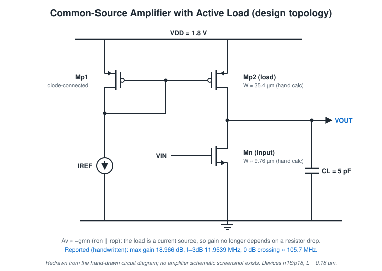
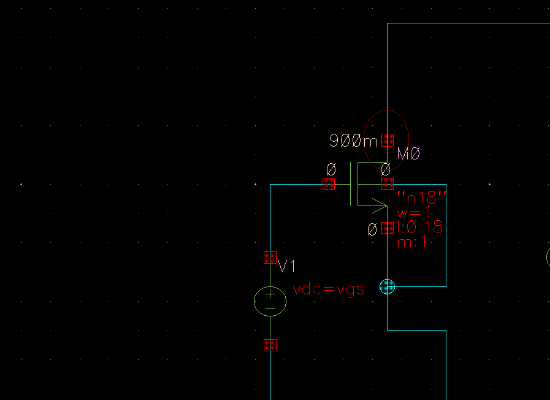
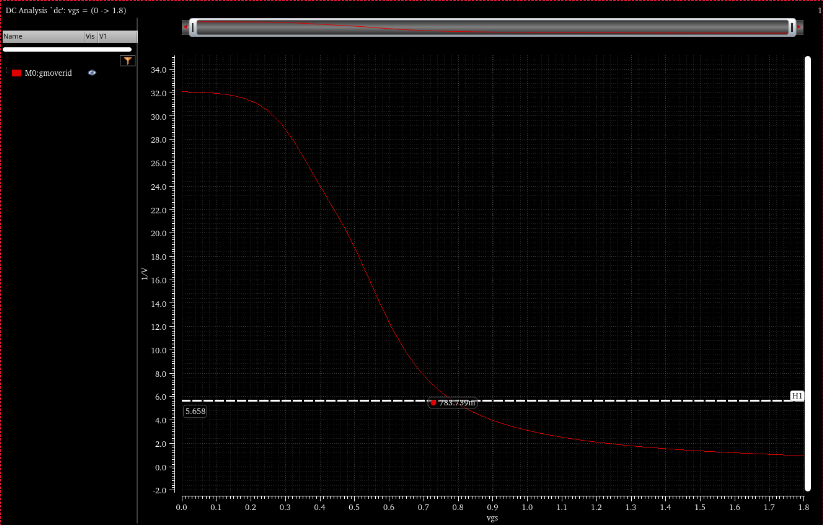
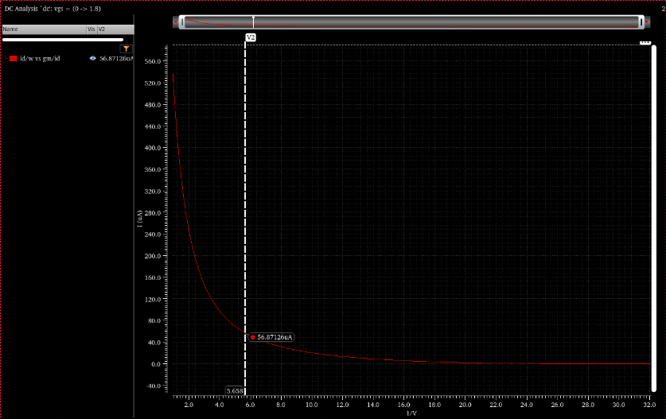
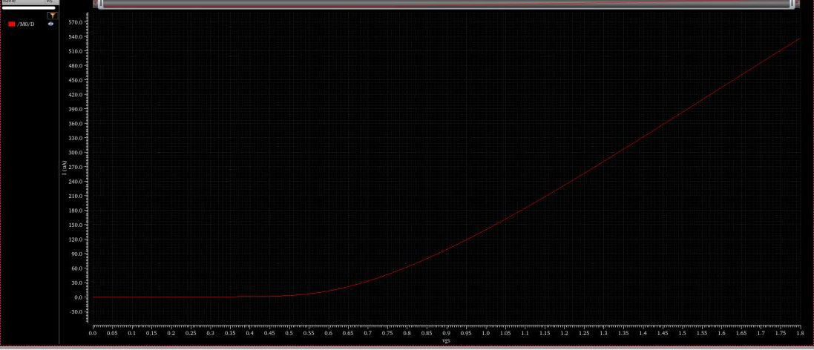
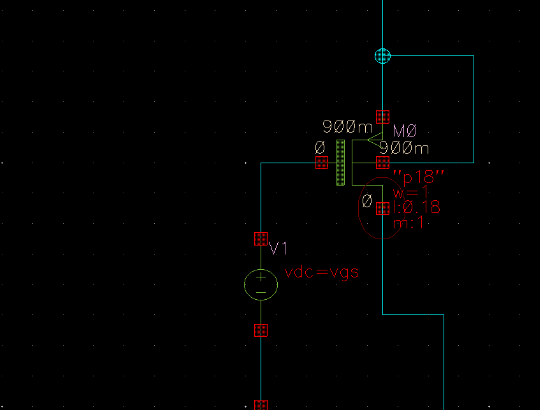
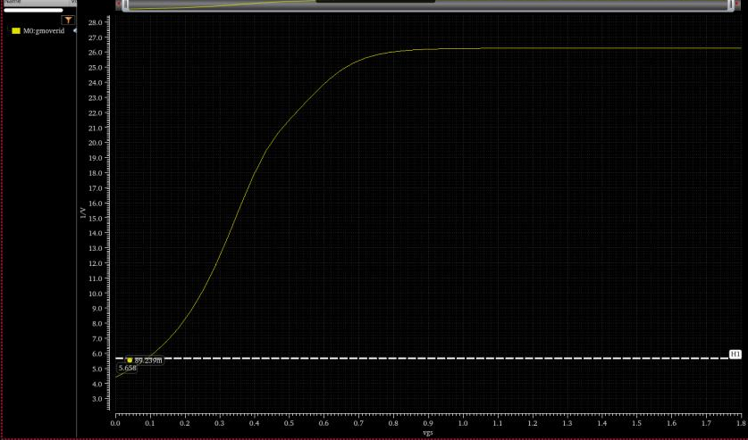
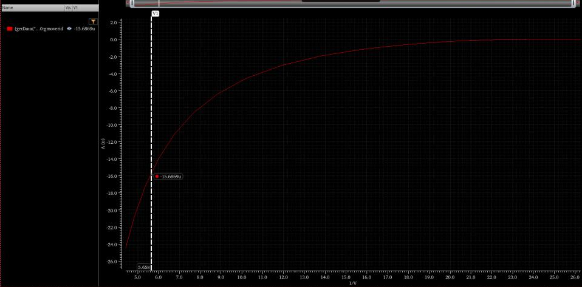
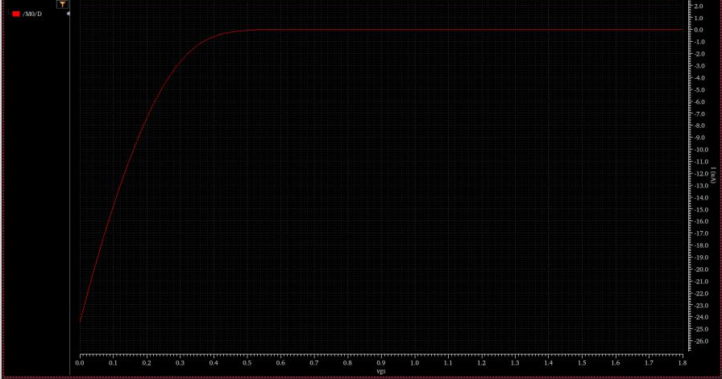

# Common-Source Amplifier with Active Load

Source: report R6, second section only. The PLL in the first section of R6 belongs to [pll-cadence-virtuoso](https://github.com/Tanisha110705/pll-cadence-virtuoso).

Technology: testbenches use `n18` / `p18` devices (W = 1 µm, L = 0.18 µm) in a user library whose name ends in `_scl`. That suggests the SCL 180 nm PDK, but the report does not name the PDK. These are **not** the UMC N_18_MM / P_18_MM devices used in the other studies.

## Specification

| Item | Target |
|---|---:|
| Unity-gain bandwidth | 100 MHz |
| Power | 1 mW |
| Load capacitance | 5 pF |
| Overdrive voltage | 200 mV |
| Supply | 1.8 V (used in the power calculation) |

## Topology

An NMOS common-source input (Mn) with a PMOS current-mirror load. Mp1 is diode-connected and carries a reference current I_REF; Mp2 mirrors it into the output node. C_L hangs on the output. This drawing is redrawn from the report's **hand-drawn** circuit diagram. The report contains no Virtuoso schematic of the amplifier itself.

**Why an active load.** With a resistor load, gain = gm·R_D is limited by the DC drop I_D·R_D that the supply can afford. A current-source load supplies the bias current but presents a small-signal resistance of rop, so Av ≈ −gmn·(ron ‖ rop) without the DC headroom penalty. The costs:

- the output DC level is set by the balance of two current sources, so it is sensitive and needs feedback or careful matching in practice;
- output swing is limited by the Vdsat of both Mn and Mp2.

## Design calculations (hand, R6)

| Step | Expression | Result |
|---|---|---:|
| Bias current | I_D = P / VDD = 1 mW / 1.8 V | 0.555 mA |
| gm (from UGB) | gm = 2π · f_u · C_L = 2π · 100 MHz · 5 pF | 3.14 mS |
| gm/Id | 3.14 mS / 0.555 mA | 5.658 V⁻¹ |

(An earlier line computes gm = 2I_D/V_ov with V_ov = 200 mV. The design then continues with the UGB-derived gm.)

### NMOS (n18, W = 1 µm, L = 0.18 µm, V_DS = 0.9 V)

| Quantity | Value | Source |
|---|---:|---|
| V_GS at gm/Id = 5.658 | 783.739 mV (handwritten 783.79 mV) | Marker |
| I_D/W | 56.871 A/m | Marker |
| W = I_D / (I_D/W) | 9.7588 µm | Hand calc |

| Testbench | gm/Id vs V_GS | I_D/W vs gm/Id | I_D vs V_GS |
|---|---|---|---|
|  |  |  |  |

### PMOS (p18, W = 1 µm, L = 0.18 µm)

In the testbench the PMOS source and bulk sit at 0.9 V and the drain at 0 V, with the gate swept 0 → 1.8 V.

| Quantity | Value | Source |
|---|---:|---|
| Gate voltage at gm/Id = 5.658 | 89.239 mV (so \|V_SG\| ≈ 0.81 V with the source at 0.9 V) | Marker; recorded as "Vgs" in the report |
| I_D/W | −15.6869 A/m | Marker |
| W = I_D / \|I_D/W\| | 35.44349 µm | Hand calc (0.556 mA) |

| Testbench | gm/Id vs gate voltage | I_D/W vs gm/Id | I_D vs gate voltage |
|---|---|---|---|
|  |  |  |  |

The report gives no lengths for the amplifier devices beyond the characterization L = 0.18 µm, and no value for I_REF or the Mp1 width.

## Results (reported, handwritten)

| Metric | Value | Type |
|---|---:|---|
| Max gain | 18.966 dB (≈ 8.88 V/V) | Reported (handwritten) |
| Gain at the −3 dB point | 15.9665 dB | Reported (handwritten) |
| f−3dB | 11.9539 MHz | Reported (handwritten) |
| Gain at 100 MHz | 475.455 mdB (≈ 0.48 dB) | Reported (handwritten) |
| 0 dB (unity-gain) frequency | ≈ 105.71 MHz (trailing digits illegible) | Reported (handwritten) |

The results page carries the instructor's signature, but **no AC plot, amplifier schematic or operating-point screenshot** is in the report. These numbers cannot be checked against simulation output here.

**Internal consistency (calculated here):** 8.88 V/V × 11.954 MHz ≈ 106.1 MHz, close to the reported 0 dB crossing at ≈ 105.7 MHz. That is what a single-pole response predicts. It also agrees with the 100 MHz UGB target, met by ≈ 5.7 %.

| Metric | Target | Reported |
|---|---:|---:|
| Unity-gain bandwidth | 100 MHz | ≈ 105.7 MHz |
| C_L | 5 pF | 5 pF (design input) |
| Power | 1 mW | Not measured |
| Gain | not specified | 18.966 dB |

A "model graph" sketch in the report shows the expected single-pole Bode shape annotated with these values. It is a hand sketch, not simulation output, and is not reproduced here.

## Comparison with the resistive-load CS

| | Resistive load (R2, UMC) | Active load (R6, n18/p18) |
|---|---:|---:|
| gm/Id target | 5.34 | 5.658 |
| C_L | 5 pF | 5 pF |
| Gain | 3.886 V/V (11.79 dB), simulated | ≈ 8.88 V/V (18.966 dB), reported |
| f−3dB | 25.97 MHz, simulated | 11.95 MHz, reported |
| Gain × bandwidth | ≈ 101 MHz | ≈ 106 MHz |

At nearly the same gm and C_L, both stages land near 100 MHz GBW. The active load roughly doubles gain by raising R_out and pays for it in bandwidth, the expected gain–bandwidth exchange at fixed gm/C_L. The two used different device libraries, so this is a qualitative comparison only.

## Missing / not done

- Amplifier schematic capture, AC plot and DC operating point.
- Output DC level and swing.
- I_REF value and Mp1 sizing.
- Transient, noise, PSRR, corners.
