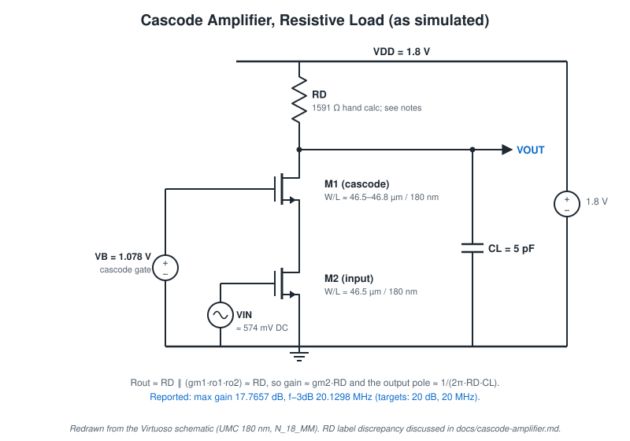
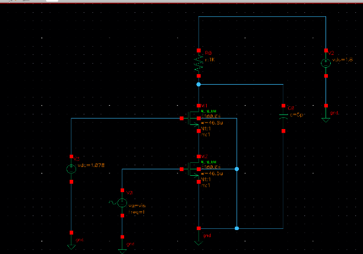
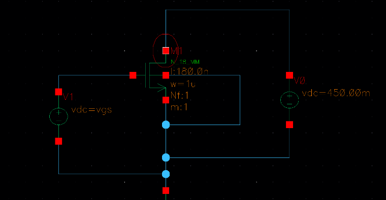
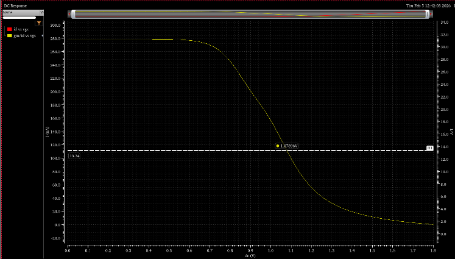
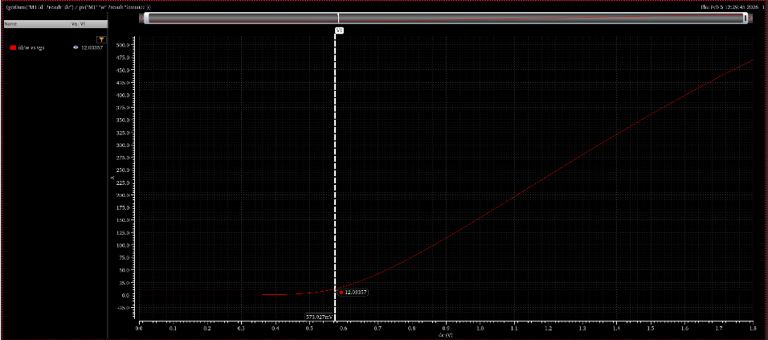
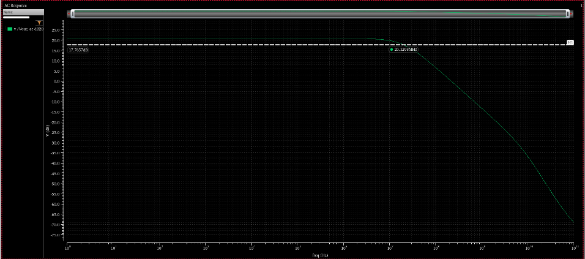

# Cascode Amplifier (Resistive Load)

Source: report R3. Technology: UMC 180 nm (`umc_18`), N_18_MM. Simulator: Spectre via ADE L.

## Design Target

| Item | Target |
|---|---:|
| Voltage gain | 20 dB (Av = 10 V/V; designed for 12 V/V with 20 % tolerance) |
| Power | 1 mW |
| Bandwidth (f−3dB) | 20 MHz |
| Load capacitance | 5 pF |
| Supply | 1.8 V |

(The typed aim in the report reads "a power of 1 mW (in dB) = 20 MHz". The handwritten aim gives the values above.)

## Topology

M2 is the common-source input device and M1 a common-gate cascode on top of it, with gate held at a DC bias. The load is a resistor R_D to VDD, with C_L at the output. Bulk terminals go to ground.

The cascode raises the resistance looking into M1's drain to ≈ gm1·ro1·ro2. M2's drain is held at a low, nearly constant voltage, so its Miller multiplication of Cgd is small. With a resistive load, though, the output resistance is R_out = R_D ‖ (gm1·ro1·ro2) ≈ R_D. Gain stays ≈ gm2·R_D and the dominant pole stays ≈ 1/(2π·R_D·C_L), exactly as the hand design assumes.

## Design Method

| Step | Expression | Result | Source |
|---|---|---:|---|
| Output pole sets R_D | R_D = 1 / (2π · f · C_L) = 1 / (2π · 20 MHz · 5 pF) | 1591 Ω | Hand calc |
| Bias current | I_D = (1.8 − 0.9) V / 1591 Ω | 0.566 mA (rounded to 0.56 mA) | Hand calc |
| Transconductance | gm = 2π · C_L · f−3dB · Av = 2π · 5 pF · 20 MHz · 12 | 7.54 mS | Hand calc |
| Efficiency | gm / I_D | 13.34 V⁻¹ (as written; 13.33 with 0.566 mA) | Hand calc |
| Headroom split | V_DS per device | 0.45 V | Hand calc; sizing testbench V_DS = 450 mV |

## Bias Selection

| Device | Quantity | Value | Source |
|---|---|---:|---|
| M2 (input) | V_GS at gm/Id = 13.34 | 573.927 mV | Marker on I_D/W–V_GS plot |
| M2 | I_D/W | 12.03357 A/m | Marker |
| M2 | W = 0.56 mA / 12.03357 A/m | 46.5 µm | Hand calc |
| M1 (cascode) | Bias voltage at gm/Id = 13.34 | 1.078 V (marker 1.07896 V) | Marker on gm/Id plot; schematic `vdc=1.078` |
| M1 | I_D/W | 11.95023 A/m | Hand calc |
| M1 | W = 0.56 mA / 11.95023 A/m | 46.8 µm | Hand calc |
| Both | L | 180 nm | Schematic |

| gm/Id vs gate voltage (marker 1.07896 V) | I_D/W vs V_GS (marker 12.03357 at 573.927 mV) |
|---|---|
|  |  |

At the screenshot's resolution, the schematic W labels read ≈ 46.5 µm for both devices; the hand calc gives 46.8 µm for M1. The cascode gate source is 1.078 V. Whether the 1.07896 V marker is a true V_GS or a gate-to-ground voltage in a stacked testbench is not resolvable from the report (see [gm-id-methodology.md](gm-id-methodology.md#worked-values-from-each-design)).

## Simulation

AC analysis of V_OUT in dB20, swept from 1 Hz to 100 GHz:

The response is flat at low frequency and then rolls off. A second, steeper slope begins above ≈ 10 GHz from the internal (M2 drain) node and device capacitances.

### Reading the AC plot

The screenshot contains two markers:

- a **horizontal marker** labelled **17.7657 dB**, and
- a **point marker** where that horizontal line meets the curve, at **20.1298 MHz**.

The report states "Max gain = 17.7657 dB" and "f3dB = 20.1298 MHz". In the plot, though, the passband plateau is drawn **above the 20 dB gridline**, and the 17.7657 dB line lies **below** it. This is how ADE is normally used to find a −3 dB point: place a horizontal marker at (peak − 3 dB) and read where it crosses the curve. On that reading, 17.7657 dB is the −3 dB level and the peak is ≈ 20.77 dB.

The peak value was never read out with a marker. This repository therefore:

- reports **17.7657 dB as the "max gain" value stated in the report**,
- **does not claim** the 20 dB target as met, and
- notes that the plot is **consistent with** a peak near 20.8 dB, which would need confirming by re-simulation.

The **20.1298 MHz** value is a marker reading on the curve and is reliable as the frequency where the response crosses 17.7657 dB.

## Results

| Metric | Value | Type |
|---|---:|---|
| Max gain (as reported) | 17.7657 dB (7.73 V/V) | Reported; see plot reading above |
| f−3dB | 20.1298 MHz | Simulated (marker) |
| C_L | 5 pF | Schematic |
| Power | Not measured | — |

## Target vs Achieved

| Metric | Target | Reported | Labelled as |
|---|---:|---:|---|
| Gain | 20 dB | 17.7657 dB | Reported. **Not claimed met**; evidence ambiguous |
| Frequency (f−3dB) | 20 MHz | 20.1298 MHz | Simulated. Met (+0.6 %) |
| Load capacitance | 5 pF | 5 pF | Schematic value |
| Power | 1 mW | — | Not simulated. The design bias 0.566 mA × 1.8 V ≈ 1.02 mW is a calculation, not a result |

## R_D inconsistency

- The hand calculation gives **R_D = 1591 Ω**.
- At the screenshot's resolution, the schematic label reads **"1K"**.
- With C_L = 5 pF, a single output pole at the measured **20.13 MHz** implies R_out ≈ **1.58 kΩ**. That matches 1591 Ω, not 1 kΩ, which would put the pole near 31.8 MHz (more with parasitics).

The AC result is therefore more consistent with R_D ≈ 1.59 kΩ than with the screenshot label. The schematic may have been captured before the final value was entered. This cannot be resolved without the original cellview.

## Limitations

- No printed operating point; saturation of M1/M2 at 0.45 V V_DS each is assumed by design, not shown.
- No supply-current measurement, so power is unverified.
- No output-swing or transient analysis.
- The report's conclusion refers to "the common source amplifier", which is imprecise wording for this cascode stage.
