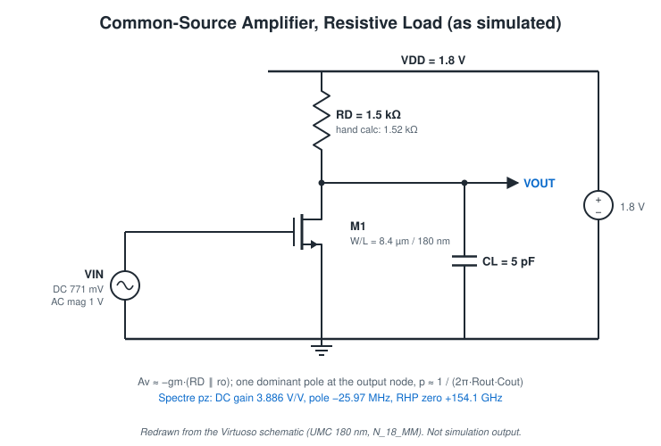
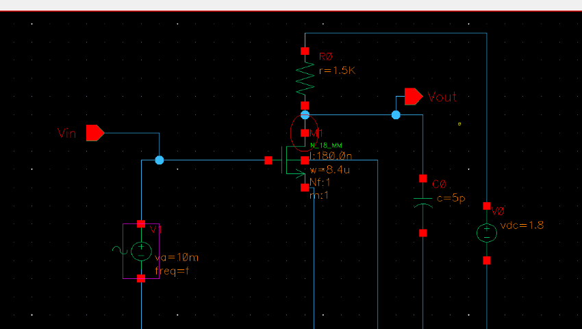
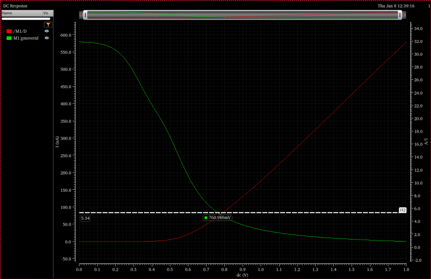
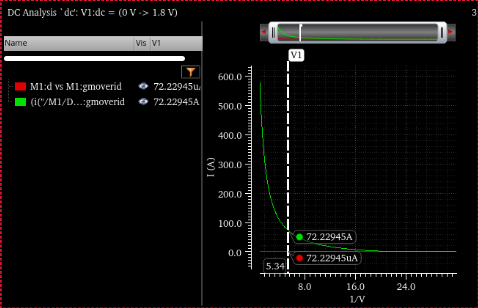
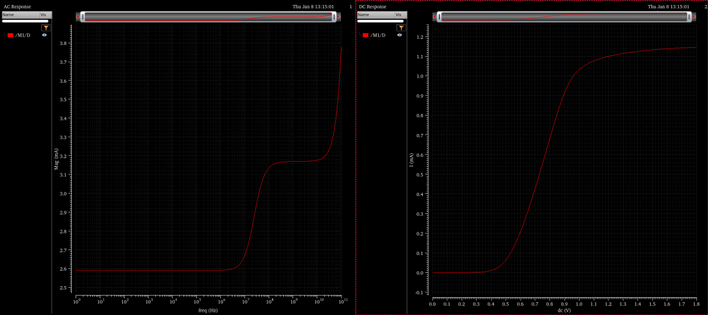
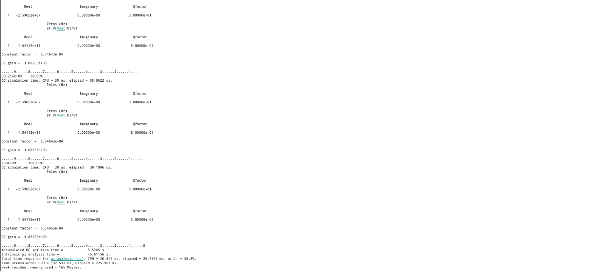

# Common-Source Amplifier (Resistive Load)

Source: report R2. Technology: UMC 180 nm, N_18_MM. Simulator: Spectre via ADE L.

## Specification

| Item | Value | Type |
|---|---:|---|
| Voltage gain \|Av\| | 4 V/V (designed for 4.8 V/V with 20 % tolerance) | Target |
| Gain-bandwidth | 100 MHz | Target |
| Load capacitance C_L | 5 pF | Target |
| Supply | 1.8 V | Schematic |
| Output DC level | 0.9 V (VDD/2, for maximum symmetric swing) | Design choice |

## Topology

Single NMOS (M1) in common-source, drain resistor R_D to VDD, C_L from output to ground, bulk to ground. The gate is driven by one source carrying both the DC bias and the AC stimulus.

| Element | Value (schematic) |
|---|---|
| M1 | N_18_MM, W = 8.4 µm, L = 180 nm, Nf = 1, m = 1 |
| R_D | 1.5 kΩ |
| C_L | 5 pF |
| VDD | 1.8 V |
| V_IN | DC 771 mV, AC magnitude 1 V (sine amplitude 10 mV also defined) |

## Design method

Hand calculation (R2 notebook):

| Step | Expression | Result |
|---|---|---:|
| Transconductance | gm = 2π · C_L · GBW = 2π · 5 pF · 100 MHz | 3.14 mS |
| Gain with margin | 4 × 1.2 | 4.8 V/V |
| Load resistor | R_D = Av / gm = 4.8 / 3.14 mS | 1.52 kΩ |
| Drain current | I_D = (1.8 − 0.9) V / 1.52 kΩ | 0.592 mA |
| Efficiency | gm / I_D | 5.34 V⁻¹ |
| V_GS | marker on simulated gm/Id–V_GS at 5.34 | 760.986 mV |
| Current density | marker on simulated I_D/W–gm/Id at 5.34 | 72.229 A/m |
| Width | I_D / (I_D/W) (computed here; blank in the notes) | 8.20 µm |

The schematic uses W = 8.4 µm, V_GS = 771 mV and R_D = 1.5 kΩ: rounded or slightly adjusted values. The adjustment is not explained in the report.

| gm/Id and I_D vs V_GS | I_D/W vs gm/Id |
|---|---|
|  |  |

## Simulation

### DC

The right panel below shows the M1 drain current against the input DC sweep (0 → 1.8 V). Conduction starts around 0.4–0.5 V, and the 771 mV bias sits on the steep, roughly linear part of the curve. The report's conclusion describes the threshold as "around 0.7 to 0.8 V". The plot shows that range is the bias region, not the threshold.

### AC

The left panel ("AC Response") plots **|I(M1/D)| in mA** against frequency, not V_OUT. It is flat at ≈ 2.6 mA (per 1 V AC input) up to ≈ 1 MHz, then steps up to a plateau of ≈ 3.17 mA between roughly 30 MHz and 1 GHz. In that range C_L AC-shorts the output, so the drain current approaches gm·v_in. The plateau implies gm ≈ 3.17 mS, close to the 3.14 mS target (read from the plot gridlines). The step is an indirect view of the output pole.

### Pole-zero (Spectre `pz`)

| Quantity | Spectre output | Interpretation |
|---|---:|---|
| DC gain V(Vout)/V1 | 3.88553 | 11.79 dB, inverting stage |
| Pole | −2.59652 × 10⁷ Hz | One real LHP pole at 25.97 MHz, the output node |
| Zero | +1.54112 × 10¹¹ Hz | RHP zero at 154.1 GHz from Cgd feed-forward, irrelevant in band |

## Results

| Metric | Target | Result | Type |
|---|---:|---:|---|
| Midband gain | 4 V/V | **3.886 V/V** (report text: ≈ 3.8 V/V) | Simulated (pz) |
| −3 dB bandwidth | — | **25.97 MHz** (single pole) | Simulated (pz) |
| Gain × bandwidth | 100 MHz | **≈ 100.9 MHz** | Calculated: 3.88553 × 25.9652 MHz |
| R_D | 1.52 kΩ | 1.5 kΩ | Schematic |

The gain lands about 3 % below the 4 V/V target and 19 % below the 4.8 V/V design value. Two causes are visible in the data, though not quantified in the report: the effective output resistance is R_D ‖ ro, not R_D, and the bias was moved slightly from the sweep values. The GBW target is met because GBW ≈ gm/(2π·C_out) does not depend on R_D.

## Limitations

- No V_OUT AC magnitude plot; bandwidth comes only from the pole location.
- No transient run, so output swing around the 0.9 V bias is not shown.
- No printed DC operating point, so saturation of M1 is inferred, not shown (see [analysis-methods.md](analysis-methods.md#operating-region-verification)).
- Single corner, 27 °C.
