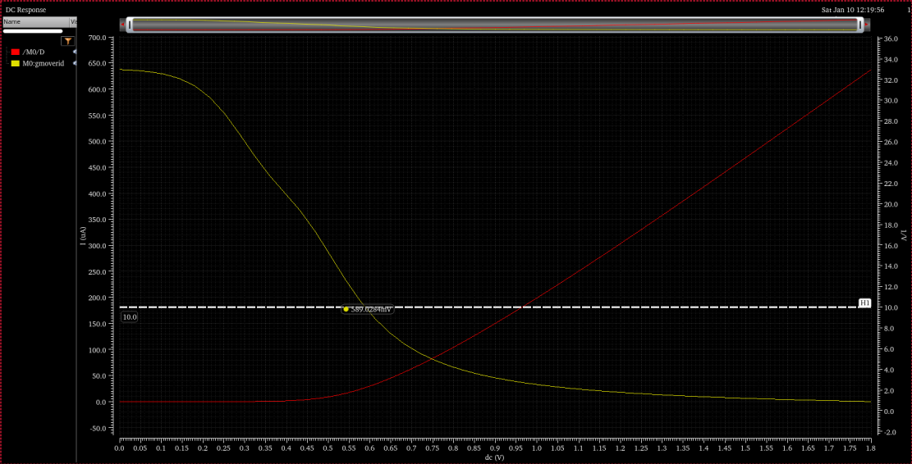
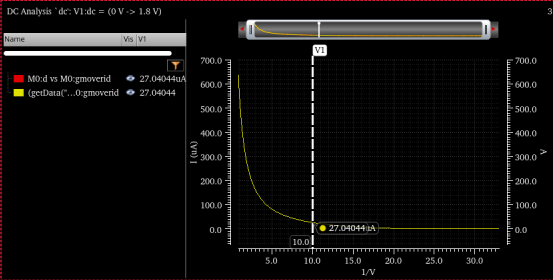
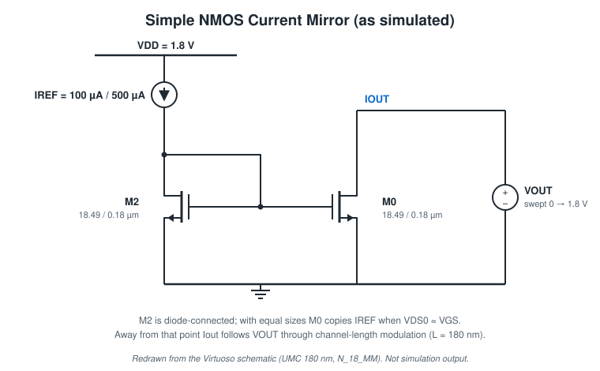
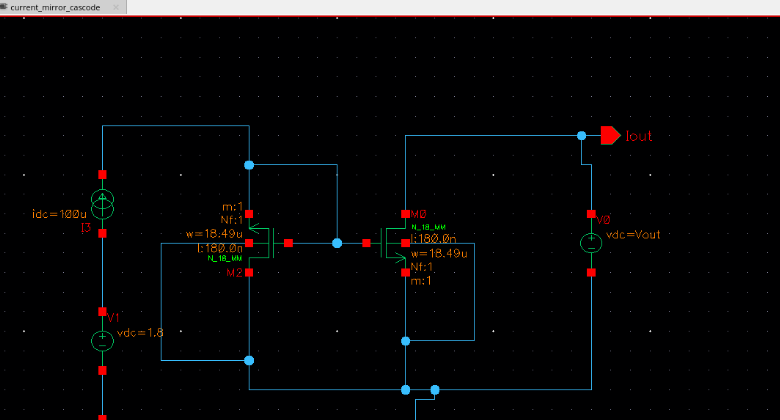
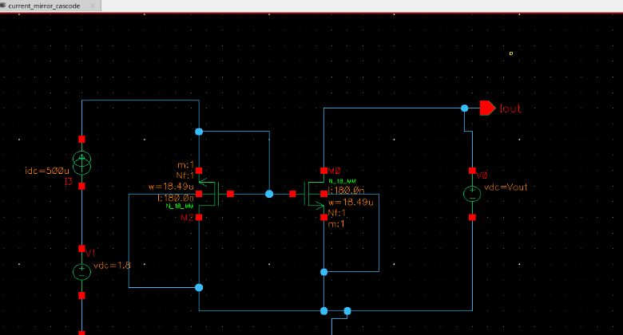
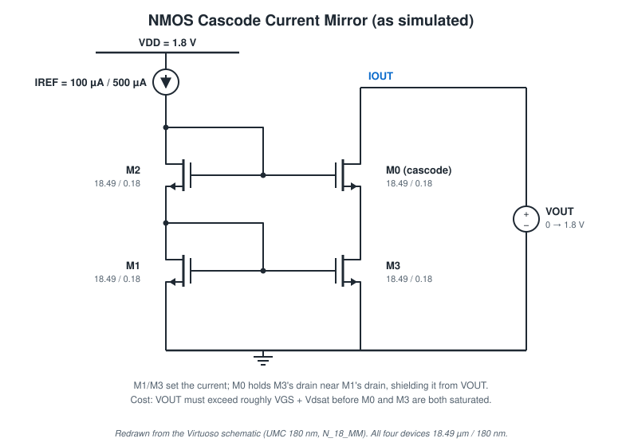
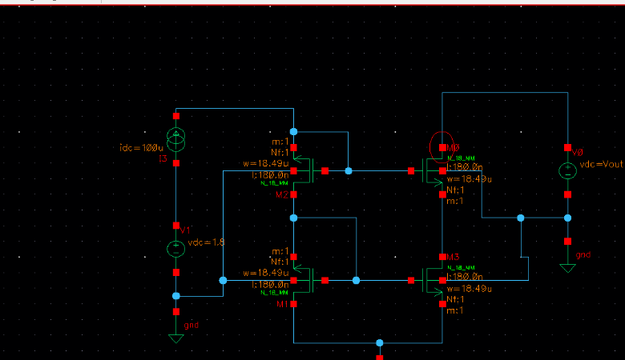
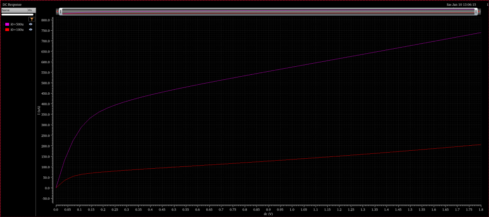
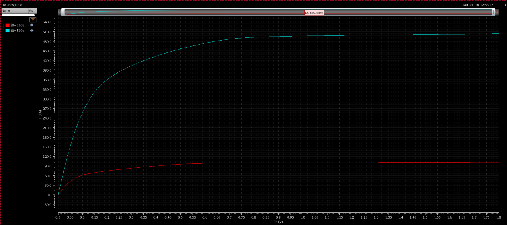
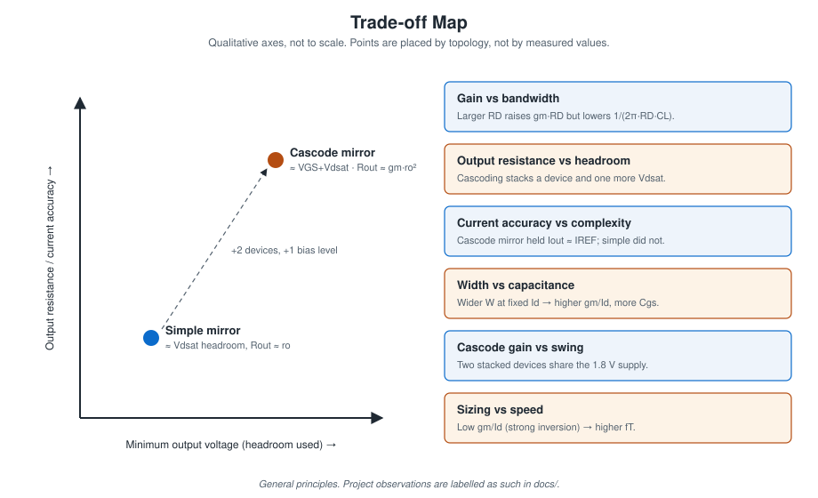

# Current Mirrors

Source: report R2. Technology: UMC 180 nm, N_18_MM. All devices W/L = 18.49 µm / 180 nm. Supply for the reference branch: 1.8 V.

## Goal

Design a simple and a cascode NMOS current mirror with the gm/Id method for I_OUT = 100 µA and I_OUT = 500 µA, assuming a 200 mV overdrive (Vdsat).

## Sizing

| Step | Value | Source |
|---|---:|---|
| Overdrive assumption | 200 mV | Aim |
| gm = 2 I_D / V_ov at 100 µA | 1 mS | Hand calc |
| gm/Id | 10 V⁻¹ | Hand calc |
| V_GS at gm/Id = 10 (W = 1 µm, V_DS = 1.8 V) | 589.028 mV | Marker |
| I_D/W at gm/Id = 10 | 27.040 A/m | Marker |
| W for 100 µA | 3.70 µm | Calculated here: 100 µA / 27.040 A/m |
| W for 500 µA | 18.49 µm | Calculated here: 500 µA / 27.040 A/m |
| W used in every schematic | 18.49 µm | Schematic labels |

The notebook lists W = 18.48 µm next to "100 µA". Numerically, 18.49 µm is the 500 µA width at gm/Id = 10. Both current levels were simulated with this one width, so the 100 µA runs operate at a lower current density (higher gm/Id, nearer weak inversion) than the design target.

| gm/Id and I_D vs V_GS | I_D/W vs gm/Id |
|---|---|
|  |  |

## Simple current mirror

| 100 µA schematic | 500 µA schematic |
|---|---|
|  |  |

M2 is diode-connected and carries I_REF (`idc` source from the 1.8 V supply). M0 shares its gate. The output drain is driven by a swept source `vdc=Vout` (0 → 1.8 V), and I_OUT is the M0 drain current.

**Principle.** With both devices saturated and equal sizes, I_OUT/I_REF = (W/L)₀/(W/L)₂ · (1 + λV_DS0)/(1 + λV_DS2). The copy is exact only when V_DS0 = V_DS2 = V_GS. Output resistance is ro of M0, and the compliance voltage (minimum V_OUT) is about one Vdsat.

## Cascode current mirror

Two stacked diode-connected devices (M2 over M1) form the reference. M0 (cascode) over M3 forms the output. All four devices are 18.49 µm / 180 nm.

**Principle.** M0 holds M3's drain at about the same voltage as M1's drain, so M3 copies I_REF accurately whatever V_OUT is. Output resistance rises to ≈ gm·ro². The cost is headroom: V_OUT must exceed about V_GS + Vdsat (one threshold more than the simple mirror) before both output devices are saturated. One more transistor per branch is also needed.

> **Missing evidence.** The report's figure for "cascode mirror, 500 µA" is a second copy of the **simple** mirror schematic (`idc=500u`, tab `current_mirror_simple`). The 500 µA cascode run does appear in the Iout–VOUT plot below, but its schematic was not captured.

## Results

| Simple mirror | Cascode mirror |
|---|---|
|  |  |

| Topology | Target current | I_OUT at V_OUT = 1.8 V | Behaviour over V_OUT | Basis |
|---|---:|---:|---|---|
| Simple | 100 µA | ≈ 205 µA | Rises steadily after a knee near 0.1 V (≈ 70 µA there) | Read from plot |
| Simple | 500 µA | ≈ 740 µA | Rises steadily after a knee near 0.15–0.25 V | Read from plot |
| Cascode | 100 µA | ≈ 100 µA | Flat once V_OUT ≳ 0.6 V | Read from plot |
| Cascode | 500 µA | ≈ 505 µA | Flat once V_OUT ≳ 0.75–0.8 V | Read from plot |

All values are visual gridline readings of the screenshots, accurate to a few µA at best. No marker values, output resistance or matching error were extracted in the report.

**Observations:**

- The simple mirror at L = 180 nm has a low ro. In the 100 µA case I_OUT climbs from ≈ 70 µA just past the knee to ≈ 205 µA at 1.8 V, crossing 100 µA around V_OUT ≈ 0.45–0.5 V. The "copy" is correct only near V_OUT ≈ V_GS of the reference.
- The cascode mirror holds I_OUT near I_REF over most of the range, the expected output-resistance improvement.
- The 500 µA cascode needs more V_OUT before it flattens than the 100 µA one: higher current with the same W means a larger V_GS and Vdsat to stack.

## Trade-off

The report frames the progression from simple to cascode as **accuracy and output impedance vs. voltage headroom**:

| | Simple | Cascode |
|---|---|---|
| Devices | 2 | 4 |
| Minimum V_OUT | ≈ Vdsat | ≈ V_GS + Vdsat |
| Output resistance | ≈ ro | ≈ gm·ro² |
| Current accuracy vs V_OUT | Poor at L = 180 nm (plot) | Good above the knee (plot) |
| Bias | Self-biased | Self-biased (stacked diodes); a low-voltage cascode would need an extra bias |

Rows 2–3 and the bias row are general principles; row 4 is the project observation.

## Not done

- Numeric R_out (slope of I_OUT–V_OUT) or mirror error at a defined V_OUT.
- A length sweep. A longer L would improve the simple mirror without cascoding.
- Mismatch (Monte Carlo) and corners.
- The 500 µA cascode schematic capture.
