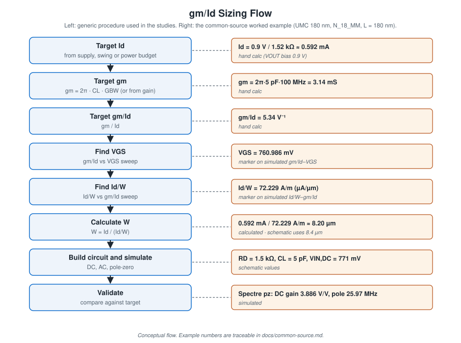

# gm/Id Design Methodology

## Why gm/Id

For a MOSFET biased at drain current I_D, the transconductance efficiency gm/Id (V⁻¹) captures the inversion level in one number:

| Region | Typical gm/Id (these plots) | Character |
|---|---|---|
| Weak inversion | ≈ 25–32 V⁻¹ | Most gm per µA; low fT, large W |
| Moderate inversion | ≈ 8–20 V⁻¹ | Compromise |
| Strong inversion | ≈ 2–8 V⁻¹ | High fT, small W, more V_GS and Vdsat |

Two properties make it useful for hand design:

1. **gm/Id ↔ V_GS** is one-to-one for a given device type, length and V_DS.
2. **I_D/W** at a given gm/Id is nearly independent of W, so a single W = 1 µm sweep scales to any width: **W = I_D / (I_D/W)**.

Specifications set I_D and gm. Their ratio is the gm/Id target, and the sweeps convert it to V_GS and W with two marker readings, no square-law model needed.

This is not a universal procedure. The lookup is only valid at the length and V_DS of the testbench, it ignores mismatch and noise, and these studies use a single minimum length (L = 180 nm) throughout.

## Procedure as used in the studies

1. **Fix I_D** from the supply or power budget, or from the output bias point (e.g. V_OUT = VDD/2 through R_D).
2. **Fix gm** from the bandwidth spec (gm = 2π·C_L·GBW) or from gain (gm = Av / R_out).
3. **gm/Id = gm / I_D.**
4. **V_GS:** sweep V_GS on a W = 1 µm, L = 180 nm device, plot `gmoverid` (an op-point output) and place a horizontal marker at the target gm/Id.
5. **I_D/W:** in the Calculator, plot `getData("M:id") / pv("M" "w")` against `gmoverid` and read I_D/W at the same gm/Id.
6. **W = I_D / (I_D/W).**
7. Build the circuit with that W and V_GS, then simulate.
8. Compare the simulated gain, bandwidth or current against the target.

## Worked values from each design

| Design | I_D | gm | gm/Id (V⁻¹) | V_GS (marker) | I_D/W (marker) | W calculated | W in schematic |
|---|---:|---:|---:|---:|---:|---:|---:|
| CS, resistive load | 0.592 mA | 3.14 mS | 5.34 | 760.986 mV | 72.229 A/m | 8.20 µm | 8.4 µm |
| Current mirrors | 100 µA | 1 mS (2I_D/V_ov, V_ov = 200 mV) | 10 | 589.028 mV | 27.040 A/m | 3.70 µm (100 µA) / 18.49 µm (500 µA) | 18.49 µm |
| Cascode amp, M2 (input) | 0.56 mA | 7.54 mS | 13.34 | 573.927 mV | 12.034 A/m | 46.5 µm | ≈ 46.5 µm |
| Cascode amp, M1 (cascode) | 0.56 mA | — | 13.34 | 1.07896 V (gate) | 11.950 A/m | 46.8 µm | ≈ 46.5 µm (label resolution) |
| Active load, NMOS (n18) | 0.555 mA | 3.14 mS | 5.658 | 783.739 mV | 56.871 A/m | 9.76 µm | no schematic |
| Active load, PMOS (p18) | 0.556 mA | — | 5.658 | 89.239 mV gate (source at 0.9 V) | −15.687 A/m | 35.44 µm | no schematic |

A/m equals µA/µm. "W calculated" is the report's own result, except for the CS row (the report leaves that line blank) and the 100 µA mirror value, which are I_D ÷ (I_D/W) computed here.

Notes:

- **CS:** the schematic's 8.4 µm and 771 mV are slightly above the 8.20 µm and 760.99 mV from the sweep. The report does not explain the adjustment.
- **Mirrors:** the schematic W matches the 500 µA calculation. At 100 µA, the same W puts the devices at a higher gm/Id (closer to weak inversion) than the 10 V⁻¹ target.
- **Cascode M1:** the report reads 1.07896 V at gm/Id = 13.34, calls it "V_GS of M1", and applies it directly as the cascode gate voltage (1.078 V to ground). M2 reaches the same gm/Id at 0.574 V, so the two sweeps cannot both be source-grounded V_GS sweeps of the same device. The testbench used for the M1 sweep is not fully legible, so this remains unresolved.

## Supporting plots

| | |
|---|---|
| CS: gm/Id and I_D vs V_GS (marker 760.986 mV at 5.34) |  |
| CS: I_D/W vs gm/Id (72.229 A/m at 5.34) |  |
| Mirror: gm/Id and I_D vs V_GS (589.028 mV at 10) |  |
| Mirror: I_D/W vs gm/Id (27.040 A/m at 10) |  |
| Cascode: gm/Id vs gate voltage (1.07896 V at 13.34) |  |
| Cascode: I_D/W vs V_GS (12.034 at 573.927 mV) |  |
