# MOSFET Characterization

Analog sizing needs device data that hand models do not supply at L = 180 nm: how much current a given V_GS produces per micron of width, how efficient that current is (gm/Id), and how fast the device is at that efficiency (fT). These studies get all three from DC sweeps of a single transistor in Spectre, before any circuit is built.

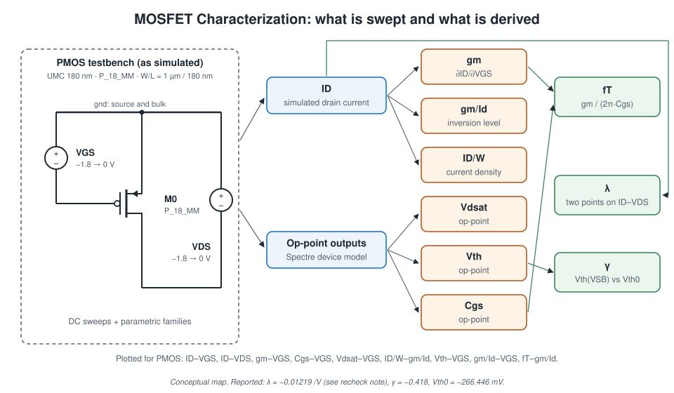

## PMOS characterization

### Setup

| Item | Value | Evidence |
|---|---|---|
| Tool | Cadence Virtuoso, ADE L + Parametric Analysis, Spectre | Window titles |
| Library | UMC 180 nm (`umc_18`) | Report procedure; "umc" in schematic tab |
| Device | P_18_MM, W = 1 µm, L = 180 nm, Nf = 1, m = 1 | Schematic |
| Connections | Source and bulk at ground; gate driven by `vdc=vgs`; drain by `vdc=vds` | Schematic |
| Sweeps | V_GS: −1.8 → 0 V; V_DS: −1.8 → 0 V; parametric families over the other variable | Plot titles and axes |
| Temperature | 27 °C | Status bar |

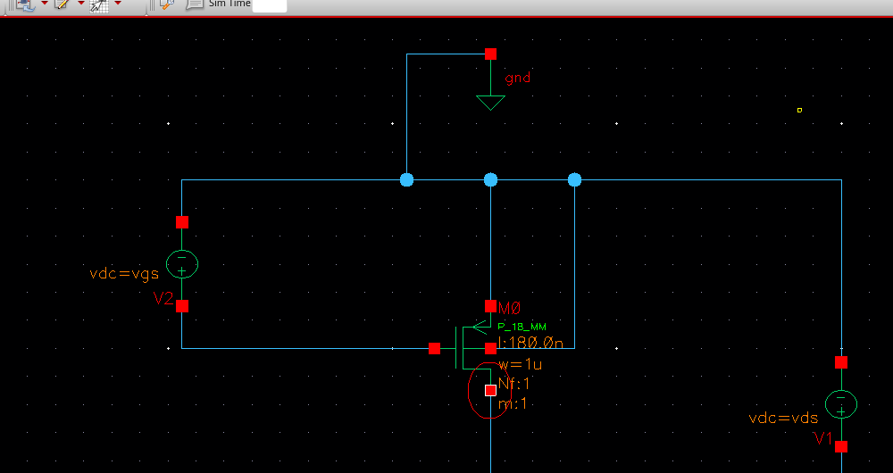

All voltages and currents are negative in this convention (third quadrant), and the plots keep that sign.

### Plots

| # | Characteristic | Plot |
|---|---|---|
| 1 | I_D vs V_GS (single V_DS) | 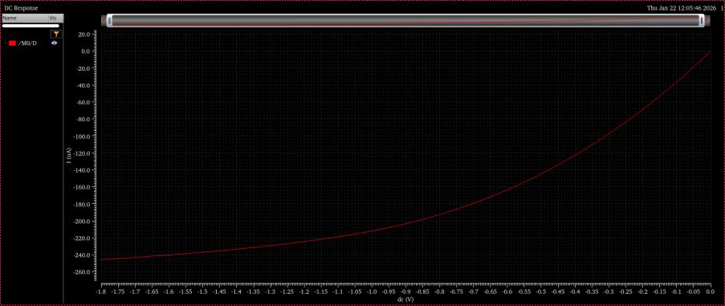 |
| 1b | I_D vs V_GS, V_DS family | 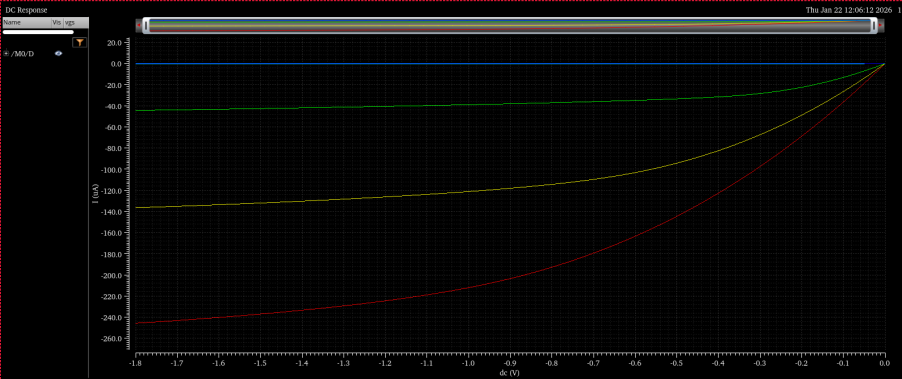 |
| 2 | I_D vs V_DS, V_GS family (output characteristics) | 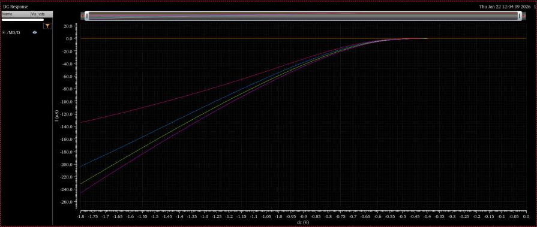 |
| 2b | I_D vs V_DS (single V_GS) | 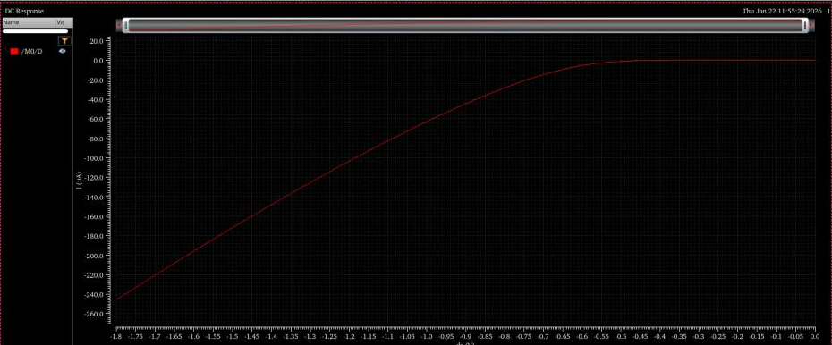 |
| 3 | gm vs V_GS | 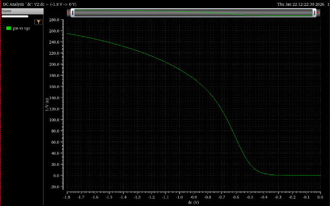 |
| 4 | Cgs vs V_GS | 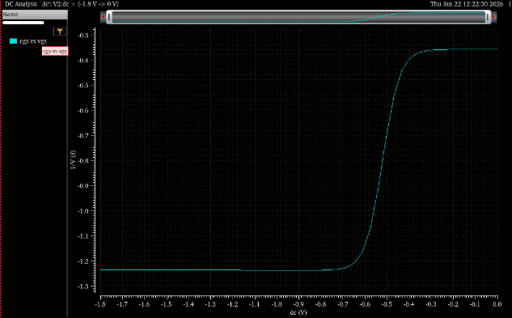 |
| 5 | Vdsat vs V_GS | 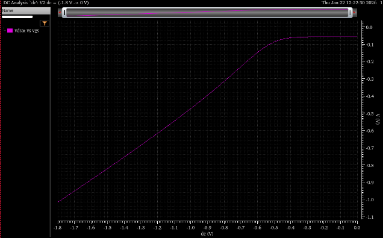 |
| 6 | I_D/W vs gm/Id | 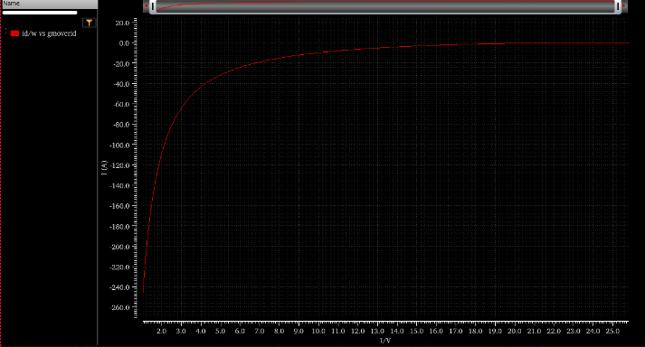 |
| 7 | Vth vs V_GS (marker −266.446 mV) | 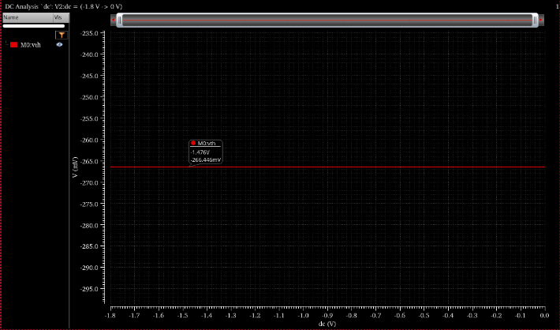 |
| 8 | gm/Id vs V_GS | 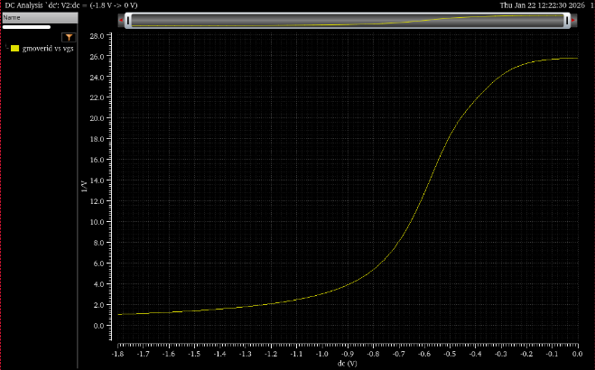 |
| 9 | fT vs gm/Id, computed as gm/(2·3.14·Cgs) | 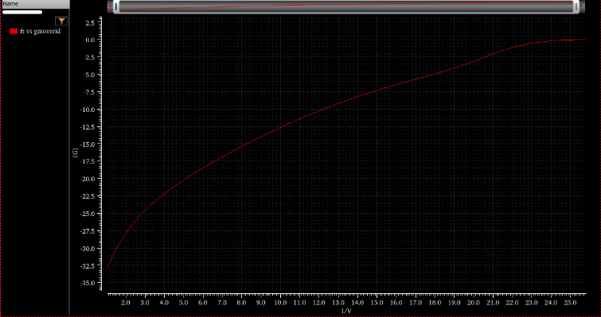 |

**Qualitative reading** (no numbers were extracted from plots 3–6, 8, 9):

- **gm/Id** rises from ≈ 1–2 V⁻¹ at V_GS = −1.8 V (strong inversion) to a plateau of ≈ 26 V⁻¹ above V_GS ≈ −0.3 V (weak inversion). The steepest change is between about −0.8 V and −0.4 V (moderate inversion).
- **I_D/W vs gm/Id** falls monotonically in magnitude as gm/Id increases. This is the lookup curve used to convert a chosen gm/Id into a width.
- **fT vs gm/Id** decreases in magnitude as gm/Id increases: the speed/efficiency trade-off. The plotted values are negative because the exported `cgs` carries the model's sign convention; only the magnitude trend is meaningful.
- **Cgs** steps between two levels as the channel forms around V_GS ≈ −0.6 to −0.4 V.
- **Vdsat** magnitude shrinks roughly linearly as |V_GS| decreases, then flattens in weak inversion.
- **Vth** is constant at −266.446 mV across the V_GS sweep at V_SB = 0.

### Channel-length modulation λ

Reported calculation (two points from the I_D–V_DS curve):

| Symbol | Value |
|---|---:|
| I_D1 | −42.61116 µA |
| V_DS1 | −1.49704 V |
| I_D2 | −41.19137 µA |
| V_DS2 | −1.28551 V |

λ = (I_D2 − I_D1) / (I_D1·V_DS2 − I_D2·V_DS1)

**Reported result: λ = −0.01219 /V.**

#### Lambda recheck

Substituting the stated values into the stated formula:

- numerator: I_D2 − I_D1 = −41.19137 − (−42.61116) = **+1.41979 µA**
- I_D1·V_DS2 = (−42.61116)(−1.28551) = **+54.777**
- I_D2·V_DS1 = (−41.19137)(−1.49704) = **+61.665**
- denominator: 54.777 − 61.665 = **−6.888**
- λ = 1.41979 / −6.888 ≈ **−0.206 /V**

The handwritten working uses −1.41979 for the numerator (I_D1 − I_D2) and −54.777 − 61.663 = −116.44 for the denominator. These two sign slips produce +0.01219, which is then written as −0.01219.

As a sanity check, the small-signal estimate λ ≈ (ΔI_D/ΔV_DS)/I_D = (1.42 µA / 0.2115 V)/42.6 µA ≈ 0.16 /V in magnitude. That is the same order as 0.206 and far from 0.012. A |λ| of about 0.15–0.2 /V is also typical for a minimum-length device.

**Status:** the project result remains **λ = −0.01219 /V (as reported)**. Its magnitude is not supported by the stated inputs and should be re-extracted from the I_D–V_DS data before it is relied on. The sign convention (negative for PMOS) is the report's and is preserved.

### Body-effect coefficient γ

γ = (V_th − V_th0) / (√(2φF + |V_SB|) − √(2φF))

| Symbol | Value | Source |
|---|---:|---|
| V_th0 | −266.446 mV | Simulated marker (plot 7) |
| V_th (\|V_SB\| = 1.8 V) | −520 mV | Handwritten; no plot in report |
| φF | 0.7 V (2φF = 1.4 V) | Assumed in the report |
| \|V_SB\| | 1.8 V | Report |

(−520 + 266.446) mV / (√3.2 − √1.4) = −253.554 mV / 0.6056 = **−0.418** (recomputed: −0.4187).

**Reported result: γ = −0.418** (units V^½; negative in the report's PMOS convention). The arithmetic checks out. Two caveats: the −520 mV input has no plot behind it, and φF = 0.7 V is larger than the 0.35–0.45 V usually assumed. A different φF would change γ.

## NMOS gm/Id data

NMOS devices were characterized inside each design rather than as a standalone study. Each design re-ran a W = 1 µm, L = 180 nm testbench at a drain bias close to the circuit's:

| Design | V_DS in testbench | Plots |
|---|---:|---|
| CS amplifier (R2) | 0.9 V (hand sketch) | [gm/Id & I_D vs V_GS](../device-characterization/nmos-gm-id/cs-gmid-and-id-vs-vgs.png), [I_D/W vs gm/Id](../device-characterization/nmos-gm-id/cs-id-per-w-vs-gmid.png) |
| Current mirrors (R2) | 1.8 V | [I_D vs V_GS](../device-characterization/nmos-gm-id/mirror-id-vs-vgs.png), [gm/Id & I_D vs V_GS](../device-characterization/nmos-gm-id/mirror-gmid-and-id-vs-vgs.png), [I_D/W vs gm/Id](../device-characterization/nmos-gm-id/mirror-id-per-w-vs-gmid.png) |
| Cascode amplifier (R3) | 0.45 V | [gm/Id vs V_GS](../amplifiers/cascode/cascode-gmid-vs-vgs.png), [I_D/W vs V_GS](../amplifiers/cascode/cascode-id-per-w-vs-vgs.png) |
| Active load (R6, n18/p18) | 0.9 V | see [active-load.md](active-load.md) |

The NMOS gm/Id curves have the same shape as the PMOS one: ≈ 32 V⁻¹ in weak inversion, falling through moderate inversion around V_GS ≈ 0.4–0.8 V.

## What was not characterized

- NMOS Vth, λ, γ as numbers.
- Numeric gm, Cgs, Vdsat or fT at any bias point.
- Any length other than L = 180 nm, so length-dependent λ is unexplored.
- Temperature or corner variation.
